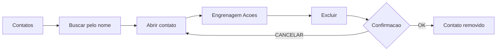

# Tutorial: Contatos - Exclusao de Contato

## O que e a exclusao de contato?

Excluir um contato e a acao de **remover definitivamente** um registro de parceiro do
cadastro. No Odoo, essa acao e via menu **Acoes (engrenagem) > Excluir**, com uma etapa
de confirmacao antes de apagar.

Na **Cosmos Advisors**, a exclusao e usada para:

- Contatos criados por engano (teste ou duplicata)
- Parceiros que nunca foram usados em nenhum modulo
- Limpeza do cadastro e boa higiene de dados

> **Importante:** exclusao e **permanente**. Por isso o Odoo exige confirmacao e o Odoo
> pode bloquear quando existem vinculos (faturas, leads, pedidos).

## Por que excluir contatos?

Um cadastro limpo e mais rapido e preciso:

| Situacao          | Consequencia sem exclusao         |
| ----------------- | --------------------------------- |
| Duplicatas        | Confusao ao buscar e vincular     |
| Contatos de teste | Polui a grade e relatorios        |
| Contato errado    | Erro em faturamento e comunicacao |

> **Excluir com proposito = menos retrabalho e menos erros.**

## Liberdade x Arquivo: quando **nao** excluir

Antes de excluir, avalie se o contato deve ser apenas **arquivado**:

| Criterio                      | Excluir | Arquivar |
| ----------------------------- | :-----: | :------: |
| Nunca usado em nenhum modulo  |   OK    |    -     |
| Ja tem fatura, lead ou pedido |    -    |    OK    |
| Pode ser reutilizado depois   |    -    |    OK    |

> **No Odoo**, quando um contato ja possui documentos vinculados, o sistema **bloqueia a
> exclusao** para proteger a integridade dos dados. Nesse caso, arquivar e a alternativa
> correta.

## Fluxo Visual

```
Contatos -> Buscar pelo nome -> Abrir o contato
  -> Engrenagem (Acoes) -> Excluir -> Confirmar -> Lista sem o contato
```

## Fluxo: Excluir um Contato

### Passo 1: Acessar Contatos

Navegue ate o modulo pelo menu superior e use a **busca** para localizar o contato pelo
nome.

> **Por que buscar pelo nome?** Evita excluir o contato errado e confirma que existe uma
> unica ocorrencia.

### Passo 2: Abrir o contato

Clique no card do contato. O formulario abre em modo leitura (readonly).

### Passo 3: Abrir o menu Acoes

Clique na **engrenagem** (menu de acoes do registro) no canto superior do formulario. O
menu traz opcoes como Arquivar, Duplicar e Excluir.

### Passo 4: Clicar em Excluir

Selecione **Excluir** no menu.

### Passo 5: Confirmar a exclusao

O Odoo abre um dialogo de **confirmacao**. Clique em **OK** para prosseguir ou
**CANCELAR** para voltar.

> **Por que essa confirmacao existe?** Exclusao e irreversivel — a confirmacao evita
> apagao acidental.

### Passo 6: Verificar a lista

Apos excluir, a lista e atualizada e o contato nao aparece mais.

## Screenshots

| Etapa                       | Arquivo                      |
| --------------------------- | ---------------------------- |
| Lista de contatos           | `01_contatos_lista.png`      |
| Formulario do contato demo  | `02_form_contato.png`        |
| Contato salvo               | `03_contato_salvo.png`       |
| Busca pelo nome             | `04_busca_contato.png`       |
| Formulario aberto (leitura) | `05_form_contato_aberto.png` |
| Menu Acoes (engrenagem)     | `06_menu_acoes.png`          |
| Dialogo de confirmacao      | `07_confirmacao_excluir.png` |
| Lista apos exclusao         | `08_contato_excluido.png`    |

## Boas Praticas

1. **Busque antes de excluir** — confirme que e o contato certo
2. **Verifique vinculos** — exclua apenas contatos sem documentos associados
3. **Prefira arquivar** quando houver historico ou duvida
4. **Nao exclua o contato da propria empresa** — a Cosmos Advisors deve permanecer como
   parceira
5. **Treine em banco de teste** — nunca exclua em producao sem conferir duas vezes
6. **Confirme o dialogo conscientemente** — apos OK nao ha volta

## Erros Comuns

| Erro                     | Causa                             | Solucao                              |
| ------------------------ | --------------------------------- | ------------------------------------ |
| "Nao e possivel excluir" | Contato com documentos vinculados | Arquivar em vez de excluir           |
| Excluiu o contato errado | Sem busca previa                  | Sempre pesquisar antes               |
| Duplicou sem querer      | Reclusao por medo de excluir      | Buscar primeiro, excluir a duplicata |

---



---

- Tutorial gerado automaticamente a partir dos scripts de automacao Playwright\*
